# leolink

A native Linux client for Reolink cameras. Qt 6, C++20, libmpv.

Talks to cameras over their own protocols — the HTTP API, RTSP, ONVIF and
Reolink's Baichuan on the local network — so nothing has to be installed on the
camera and no vendor software is involved. See
[what each feature needs](#what-each-feature-needs).

> Not affiliated with, endorsed by or supported by Reolink.

---

## What it does

- **Several cameras at once** in a grid you arrange yourself. A camera can cover
  more than one cell (2×1, 1×2, 2×2 …), or be placed automatically.
- **Volume and mute per camera**, because eight rooms at once is not a feature.
- **Motion alerts** either from the camera over ONVIF, or worked out here from
  the picture — for cameras that report nothing. The local detector takes
  drawable zones, so a tree in the wind or a neighbour's door can be left out.
- **Sound detection** with a threshold in dBFS, for what the picture misses.
- **Records to your own disk** — on motion or at the press of a button. Works
  on cameras with no SD card, because the recording happens here. A separate
  ffmpeg process copies the stream through without re-encoding, so quality is
  untouched and the processor stays idle.
- **Changes settings on the camera**: resolution, frame rate, bit rate, H.264
  profile and the picture controls. Every choice offered is one the camera
  itself reported, so no model is shown an option it cannot do. Also the
  camera's own detection area drawn on a live picture, its weekly schedules for
  detection and recording, sensitivity by time of day, privacy areas it blanks
  before anything leaves the device, users, Wi-Fi, firmware and a restart.
- **Reacts to events**: run a command, call an HTTP endpoint, publish MQTT.
  Configure it once globally or per camera.
- **Event log** with the still and recording captured at the time, filterable
  per camera.
- **Finds cameras** on the network by ONVIF discovery.
- **NVRs**: testing the connection to a recorder notices what it is and offers
  its cameras by name, so eight of them are added in one go. Each one is then
  an ordinary camera in the grid, with its own settings, detection and
  recording — the recorder is only how it is reached.
- **Fits the desktop**: follows the system light/dark palette, tray icon,
  hideable menu bar and window decoration for wall displays.
- **Recordings on the camera's SD card**: search by period, play, download.
- **Any RTSP source**, not only Reolink — the custom-URL transport takes
  anything libmpv can open.
- **Four ways to get the picture**: RTSP, HTTP-FLV, the camera's own Baichuan
  protocol, or a URL of your own. Baichuan is the answer for cameras that keep
  RTSP switched off, and it does not consume one of the camera's few web
  sessions.
- **Passwords where you want them**: in the configuration file, in the system
  keyring, or read from a command such as `pass` or `secret-tool` — chosen per
  camera, because a wall display that starts on its own cannot unlock a keyring.
- **Diagnostics that can be handed to somebody else.** Errors and warnings are
  always recorded; switching on detailed logging adds the whole conversation
  with the camera. Help ▸ Diagnostics shows it, filters it, and copies a report
  with the machine's details attached — **passwords, session tokens and public
  addresses removed before anything is written**, so it can be pasted into a bug
  report as it stands.
- **Pre-recording and round-the-clock recording.** A motion recording can
  contain the seconds *before* the trigger, and a camera can record without
  stopping into a rolling window that always holds the last day — or week.
- **Twelve languages.** Arabic, Chinese, English, French, German, Hindi,
  Italian, Japanese, Portuguese, Russian, Spanish and Turkish — right-to-left
  layout included.

## What it looks like

Real screenshots of the application running. The camera tiles play freely
licensed photographs rather than anybody's front door — see
[docs/screenshots/CREDITS.md](docs/screenshots/CREDITS.md) for where those come
from and what was blurred.

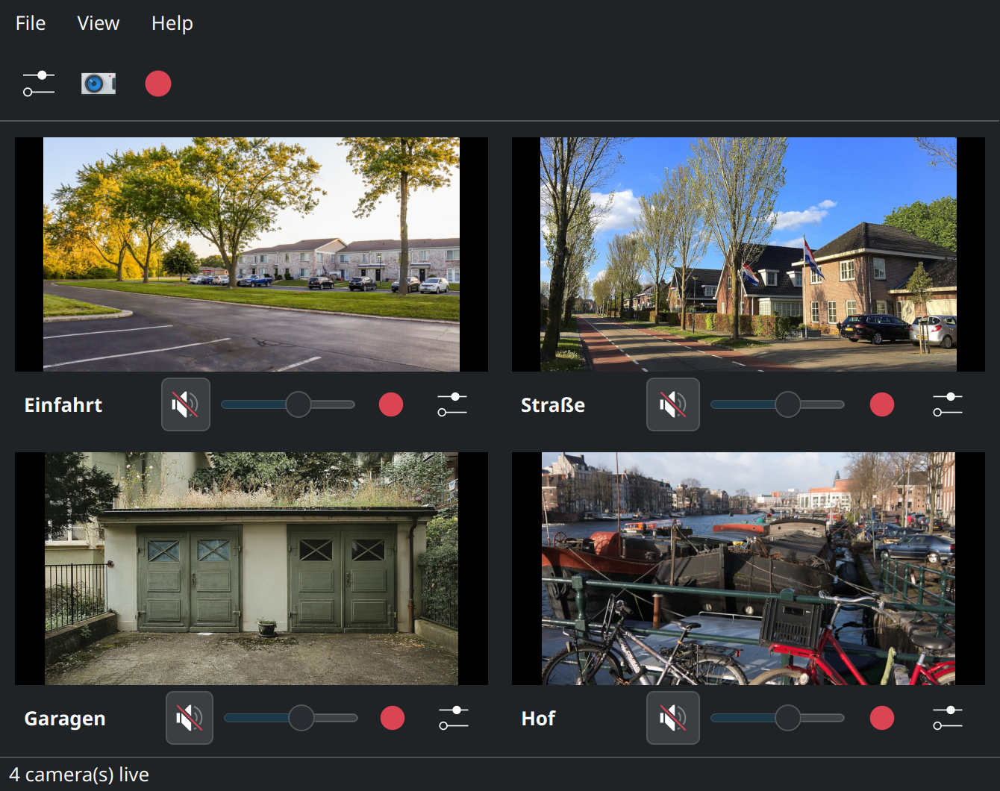

### Settings

| | |
|---|---|
| 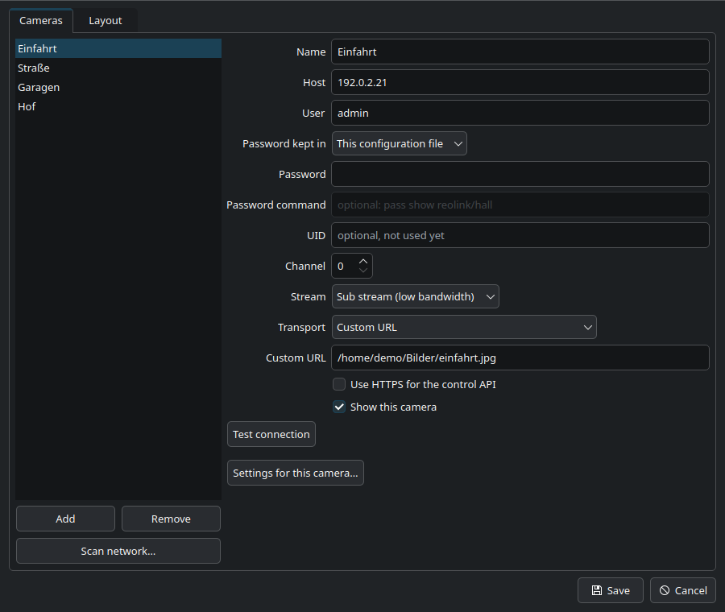 | 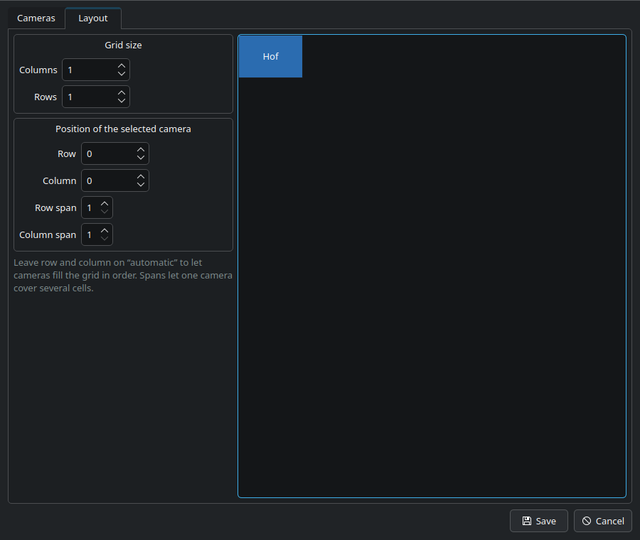 |
| **Cameras** — address, credentials, stream and transport | **Layout** — the grid, and which cell a camera occupies |
| 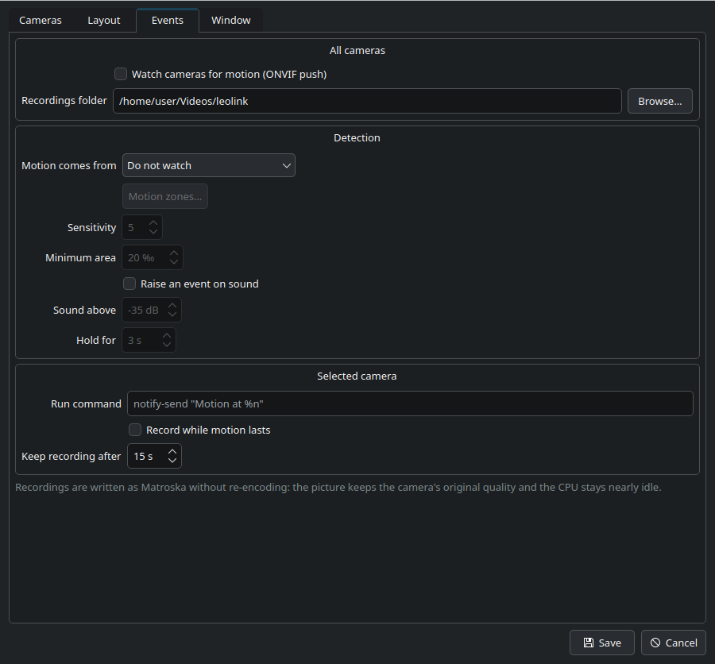 | 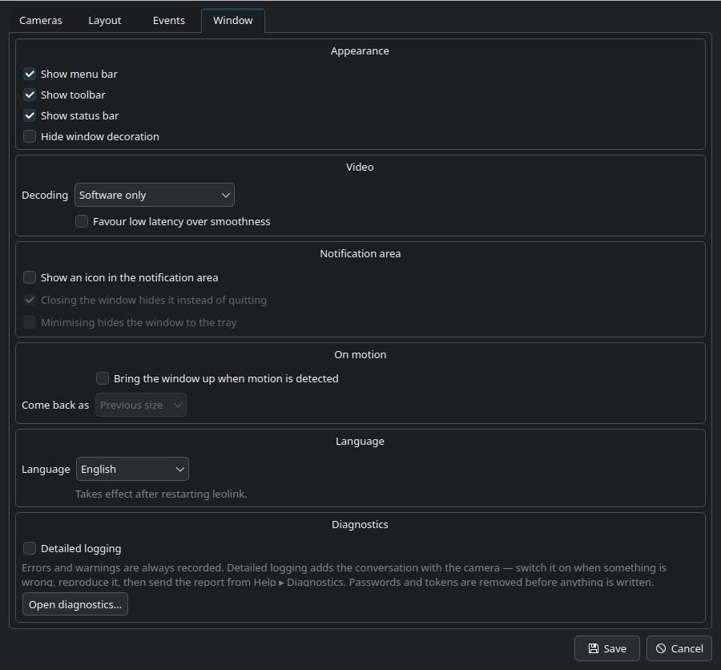 |
| **Events** — what counts as motion and what happens then | **Window** — chrome, tray, language, decoding, diagnostics |

### Camera settings

Everything here is built from what the camera itself reports, so a model that
cannot do something simply does not show it.

| | |
|---|---|
| 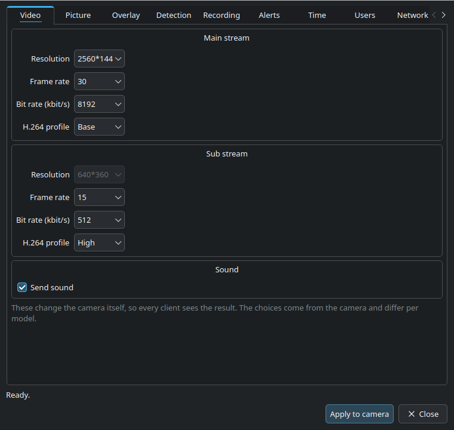 | 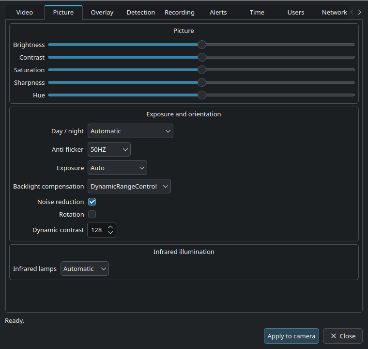 |
| **Video** — resolution, rate, bitrate, profile, microphone | **Picture** — brightness, contrast, day/night, infrared |
| 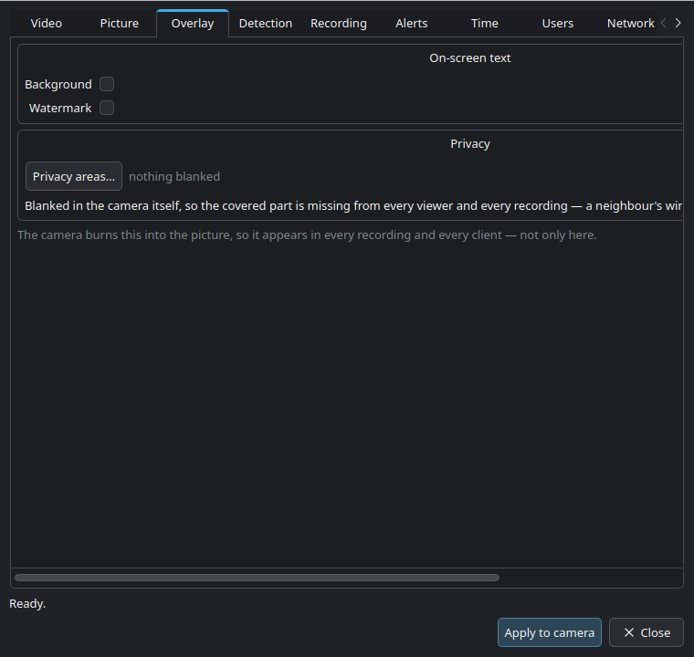 | 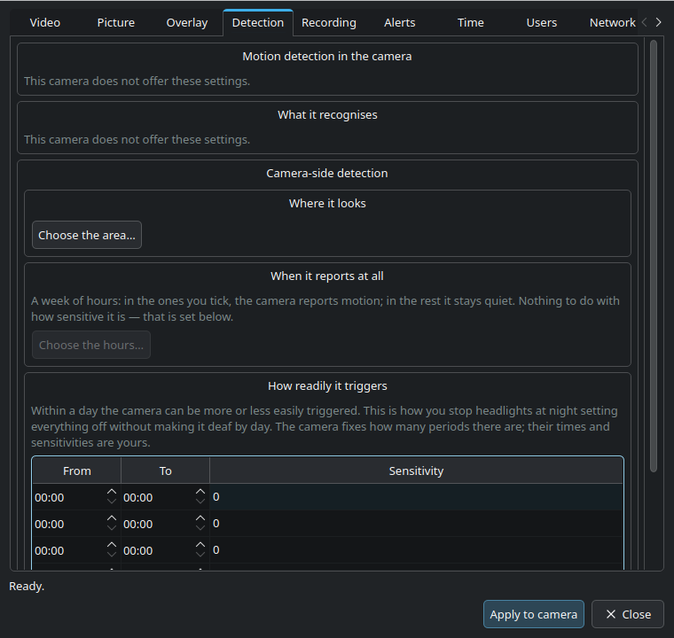 |
| **Overlay** — on-screen text, and the privacy areas the camera blanks | **Detection** — where it looks, when it reports, how readily it triggers |
| 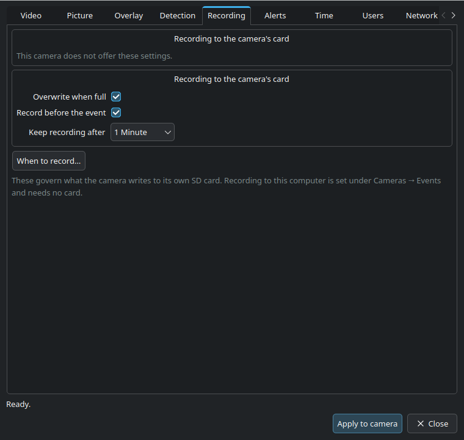 | 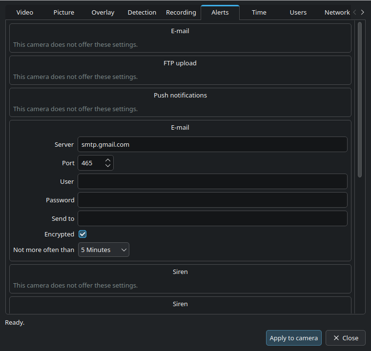 |
| **Recording** — to the camera's own card, and when | **Alerts** — e-mail, FTP, push, siren and spotlight where fitted |
| 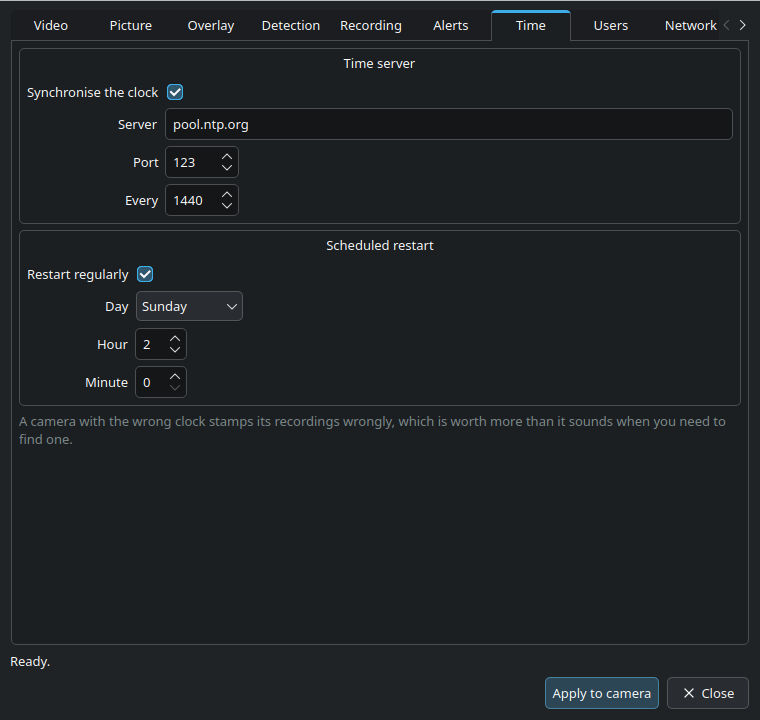 | 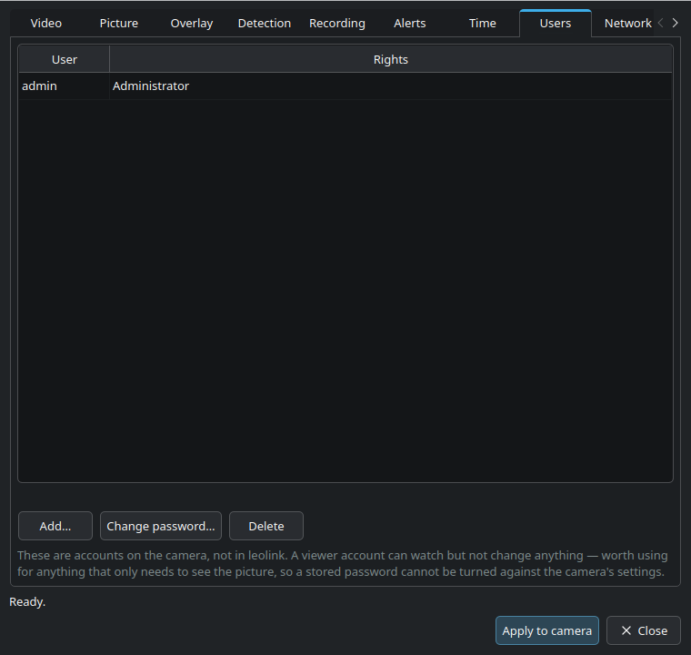 |
| **Time** — clock, time zone, NTP | **Users** — add, remove, change passwords |
| 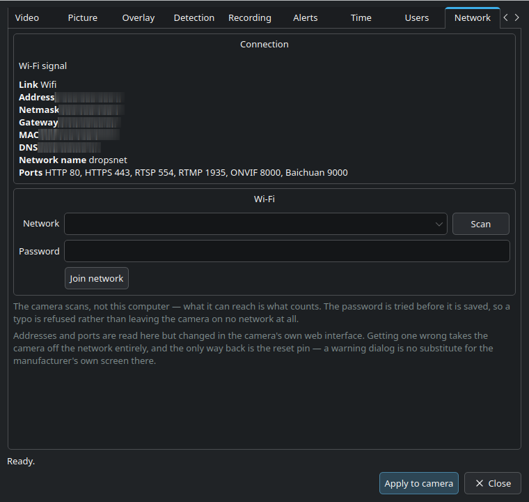 | 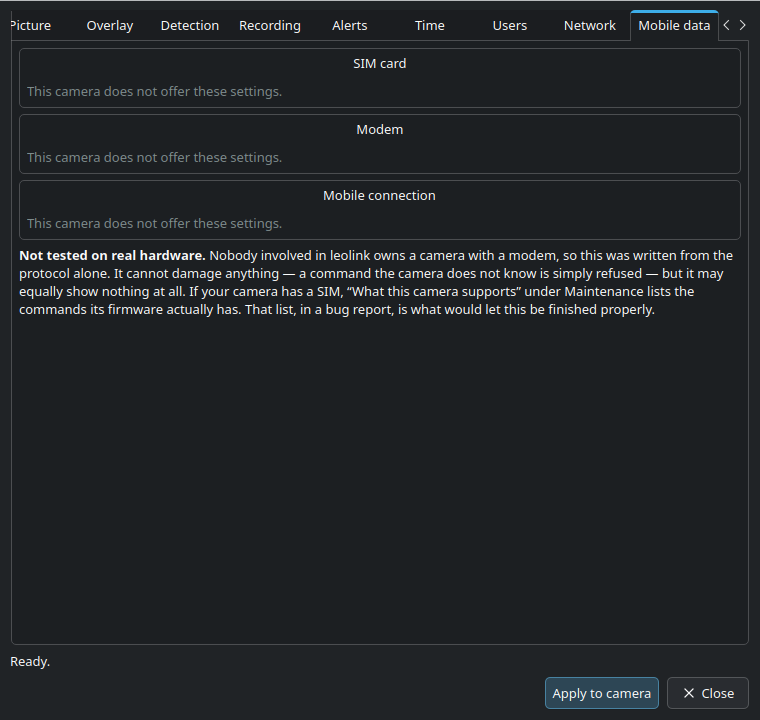 |
| **Network** — link, addresses, ports, Wi-Fi | **Mobile data** — SIM and modem, on cameras that have one |
| 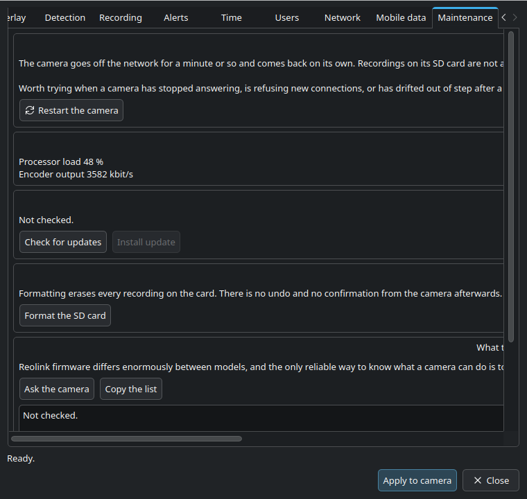 | |
| **Maintenance** — condition, firmware, storage, and what this camera supports | |


## Requirements

Qt 6.4 or newer and libmpv. `ffmpeg` on PATH is needed for recording — without
it everything else still works and recording reports that it is unavailable.

A graphics stack with VA-API or VDPAU is optional but worth having for
main-stream resolutions.

## Building

```bash
# Debian, Ubuntu
sudo apt install cmake ninja-build qt6-base-dev qt6-svg-dev qt6-tools-dev \
                 qt6-tools-dev-tools libmpv-dev qtkeychain-qt6-dev

# Fedora
sudo dnf install cmake ninja-build gcc-c++ qt6-qtbase-devel qt6-qtsvg-devel \
                 qt6-qttools-devel mpv-devel qtkeychain-qt6-devel

cmake -S . -B build -G Ninja -DCMAKE_BUILD_TYPE=Release
cmake --build build
./build/leolink
```

Install system-wide, with the desktop entry and AppStream metadata:

```bash
sudo cmake --install build
```

Build a `.deb`:

```bash
cd build && cpack
```

### Tests

```bash
ctest --test-dir build --output-on-failure
```

No camera is needed. `tests/FakeCamera` plays the camera's side of Baichuan on
the loopback interface: the login handshake, AES and XOR as the firmware does
them, and answers from captures of four real cameras in `tests/fixtures`. The
captures have everything identifying replaced. Nothing is sent beyond the
machine's loopback interface. The tests cover:

- **the login:** asking for AES first, sending the credentials under XOR, and
  following a camera that grants only XOR
- **the cipher:** checked against the FIPS-197 and SP 800-38A vectors
- **messages:** the extension and body are encrypted separately, and alarms
  arriving in between are stepped over
- **matching the HTTP API:** for the two cameras that have both, every
  settings answer agrees with what that camera's own HTTP API said, field by
  field
- **writing back:** for every write, sending a section back unchanged leaves
  the camera's document exactly as it was, and changing one field changes that
  field and nothing else
- **choosing how to reach a camera:** the probe's verdict on each model, the
  order of automatic transports, and when settings go over Baichuan
- **video tables:** the transport-stream tables Baichuan video is wrapped in,
  checked by a parser of their own
- **adding a camera:** the camera list driven as a person would. That covers
  add, remove, test connection and save, and the saved file read back on the
  next start, including files written by older versions.
- **a camera's settings dialog:** opened on an E1 Pro over Baichuan, every
  page filled, Apply with nothing changed leaving the camera untouched, and
  one edit reaching the camera alone
- **the HTTP API:** one login however many requests are waiting, a lapsed
  session renewed, a busy camera asked again, HTTPS where that is all there
  is, and no HTTP at all for a camera with no web server. A fake web server
  plays the camera.
- **discovery:** real ONVIF replies, including an E1 Zoom's, which never
  mentions Reolink
- **motion from the camera:** the ONVIF subscription and long poll against an
  E1 Zoom's real replies. That includes the WS-Security digest, each kind of
  event kept apart, and a recorder's events sent to the right channel.
- **events:** placeholders, the command, the webhook, MQTT against a broker of
  its own, and the event log
- **the log:** passwords, tokens and public addresses kept out of the log
  and out of the diagnostics report
- **the program itself:** `--version` and `--help`

Building them needs Qt Test, which comes with `qt6-base-dev`. To leave them out,
configure with `-DLEOLINK_BUILD_TESTS=OFF`.

## Configuration

Settings live in `~/.config/leolink/config.json`, mode 600. Where each camera's
password lives is per camera, under **Password kept in**:

- **This configuration file** — in clear text, readable only by you. The
  default, and the only one that works on a machine which starts unattended.
- **A command** — leolink runs it and reads the secret from its output, so the
  password never enters the file:

  ```
  pass show reolink/hall
  secret-tool lookup service reolink host 192.168.1.10
  ```

- **The system keyring** — the desktop's own secret service, which is what
  GNOME Keyring and KWallet both answer to. Type the password once and it moves
  there when you save. Needs `qtkeychain` at build time; without it the choice
  is not offered.

A keyring is normally locked until somebody logs in, so a wall display that
boots straight into leolink with nobody at the keyboard is better served by the
file or by a command. That is why the file remains the default.

Recordings and event stills go to `~/Videos/leolink` unless told otherwise.
The event log is `~/.local/share/leolink/events.jsonl`, one JSON object per
line, and is pruned to 90 days on start.

## Keyboard

| | |
|---|---|
| `Ctrl+K` | cameras — the list, the grid, and the way into each one |
| `Ctrl+,` | settings |
| `Ctrl+M` | menu bar on/off |
| `Ctrl+Shift+D` | window decoration on/off |
| `Ctrl+S` | snapshot every camera |
| `Ctrl+R` | start/stop recording every camera |
| `Ctrl+L` | event log |
| `F11` | full screen — the whole grid, every bar hidden |
| `Esc` | leave full screen |
| double-click a tile | that camera alone fills the screen, again to go back |
| right-click | menu — also the way back when everything else is hidden |

In full screen the controls under each camera withdraw a few seconds after the
pointer stops, and the pointer goes with them; moving it brings both back.

With the decoration hidden, drag the strip beneath any camera to move the
window.

## Event placeholders

Available in commands, webhook bodies, MQTT topics and payloads:

| | |
|---|---|
| `%n` | camera name |
| `%i` | camera id |
| `%h` | host |
| `%t` | ISO 8601 timestamp |
| `%e` | event type |
| `%s` | `on` / `off` |
| `%f` | recording file, if one was started |
| `%p` | still image file |

With no webhook body or MQTT payload given, a small JSON document describing the
event is sent instead.

## Protocols

The reverse engineering behind this is written up in
[docs/protocol.md](docs/protocol.md): the HTTP CGI API and its error codes, the
streaming paths, ONVIF's two firmware quirks, and the Baichuan protocol on port
9000 including its four-message login handshake.

Baichuan is not needed for ordinary viewing of a wired camera. It matters for
battery models that keep RTSP switched off, for cameras with no web server at
all (an E1 Pro has none, and an E1 can have it switched off), for reaching a
camera by UID from outside the network, and for two-way audio.

### What each feature needs

At startup leolink asks every camera which of these it offers. It tries each
port, and over Baichuan reads the camera's own list of which services are
switched on. A service counts only when both agree. After that a feature uses
what is there and leaves alone what is not, so a camera without a web server
is never asked to log in to one. The camera dialog's **About** page shows what
was found.

| | HTTP API<br>80 / 443 | HTTP-FLV<br>80 / 443 + RTMP | RTSP<br>554 | ONVIF<br>8000 | Baichuan<br>9000 |
|---|:-:|:-:|:-:|:-:|:-:|
| Live video | | 1st choice | 2nd | | 3rd |
| Camera settings | ✓ | | | | when there is no web server ¹ |
| About page: model, hardware, firmware, serial | ✓ | | | | ✓ |
| Still for drawing the detection area | ✓ | | | | — |
| Motion alerts from the camera | | | | ✓ | |
| Motion and sound detected here | | ✓ | ✓ | | — ² |
| Recording to disk, pre-roll, round the clock | | ✓ | ✓ | | — ² |
| Recordings on the SD card: search, play, download | ✓ | | | | — |
| Wi-Fi strength on the tile | ✓ | | | | — |
| Finding cameras on the network | | | | ✓ discovery | |
| Reaching a camera by UID (P2P) | | | | | ✓ |
| Sending sound to the camera's speaker (`--talk`) | | | ✓ ONVIF backchannel | | |

✓ is the protocol a feature uses, and — means it is not available over that
protocol yet. An empty cell means the feature never uses that protocol.

With the transport set to **Automatic**, live video takes the first of
HTTP-FLV, RTSP and Baichuan that the camera offers. They are ranked by what
they cost this machine. HTTP-FLV is a single HTTP connection. RTSP adds a
session and RTP reassembly. Baichuan is done entirely by leolink: login,
decryption, unpacking the camera's container and repackaging it as MPEG-TS for
the player. If a transport fails, the next one is tried. Choosing a transport
by hand overrides all of this. Cameras that never answered the probe are
treated as offering everything, which is how leolink behaved before it asked.

¹ Over Baichuan the settings dialog has video, picture, on-screen text, privacy
mask (on and off, but not drawing areas), detection area, sensitivity and AI
detection types, the recording and alert schedules, the e-mail, FTP, push and
siren switches, network ports, Wi-Fi, time zone and clock, infrared and status
lights, storage, and restart. It does not have user accounts, e-mail and FTP
server details, daylight saving and NTP, firmware update, formatting the card,
or snapshots. Those panels say so instead of failing. The message numbers and
the mapping of each field are in [docs/protocol.md](docs/protocol.md#settings).

² Baichuan video is re-served on a loopback port that exists only while a tile
is playing it, so there is no address for ffmpeg to open. A camera that offers
nothing but Baichuan, such as an E1 with its web server and RTSP switched off,
can be watched and configured but not recorded or analysed here.

## Status

Developed against an **RLC-410W**. Other Reolink models speak the same
protocols, and leolink asks each camera what it supports rather than assuming.

Also run against these, with every protocol each one offers:

| Camera | Firmware | Offers | Video (automatic) | Settings over |
|---|---|---|---|---|
| Video Doorbell WiFi | v3.0.0.6460 | HTTP, HTTPS, RTMP, RTSP, ONVIF, Baichuan | HTTP-FLV | HTTP API |
| E1 Zoom | v3.1.0.4417 | HTTPS, RTMP, RTSP, ONVIF, Baichuan | HTTP-FLV over HTTPS | HTTP API |
| E1 Pro | v3.1.0.3149 | RTSP, ONVIF, Baichuan | RTSP | Baichuan |
| E1, web server and RTSP off | v3.1.0.1643 | Baichuan | Baichuan | Baichuan |

The E1 Zoom answers both ways, so the Baichuan settings were checked against
its HTTP API field by field. Writes over Baichuan were then tested on the E1
and an E1 Pro by changing each setting, reading it back and restoring it. The
camera's own settings document was identical afterwards.

Verified against real hardware: the HTTP API, RTSP and HTTP-FLV streaming,
snapshots, ONVIF discovery and motion push, and Baichuan — login *and* video.
The Baichuan container was worked out from a capture rather than from the
published notes, which have the block magics byte-reversed; see
[docs/protocol.md](docs/protocol.md). Measured on the sub stream: 150 frames in
ten seconds, 640x352 High profile, no decode errors.

Writing settings was tested by round trip — read a section, write it back
unchanged, confirm the camera accepts it. That is what caught `SetAlarm`
refusing the very value `GetAlarm` had just returned; the detection area, the
schedules and the sensitivity bands were then verified by editing one, reading
it back changed, and restoring it.

Packaging: `.deb`, `.rpm`, AppImage and Flatpak all build. The Flatpak
compiles libplacebo, libass and libmpv from source against the KDE runtime and
picks libmpv's LGPL configuration, so the bundle does not impose GPL terms.

The local motion detector was checked against both a busy scene and a still
one: traffic footage changed 6.3% of watched pixels on average, a static camera
0.00% with a peak of 0.03%. The default threshold of 15‰ sits between the two
with room to spare.

Not yet verified, because the test camera cannot: **playback from the SD card**
(none fitted, so every search answers -17), the **P2P path** (no P2P-capable
camera here) and **mobile data** (no camera with a modem). All three are
implemented from the documented protocol and report what the camera actually
said rather than guessing, so a first run on real hardware should show plainly
where reality differs.

If you have such a camera, two things would genuinely help: the output of
`leolink --baichuan-p2p <UID>`, and — for an LTE model — the list from
**Maintenance ▸ What this camera supports**, which asks the camera which
commands its firmware actually has. Guessing at command names from here is the
only reason the mobile-data screen is marked untested.

One thing that could not be established from here: **which weekday the camera's
168-character schedule starts on.** It is 7×24 and Monday-first is the ISO
convention, so that is what the editor labels. A schedule cannot be read back in
a form that reveals the order, and this camera's web interface has no schedule
screen to compare against. If your recordings land a day out, say so — it is one
constant in `CameraSettingsDialog.cpp`.

Missing before a Flathub submission: **screenshots**. They must not show a real
camera feed; add a camera with the custom-URL transport pointing at freely
licensed footage, then capture the window.

Two-way audio is not implemented. Baichuan carries it and the transport is now
in place, so it is the obvious next thing.

## Credit

The Baichuan protocol was originally reverse engineered by
[thirtythreeforty/neolink](https://github.com/thirtythreeforty/neolink), now
maintained at
[QuantumEntangledAndy/neolink](https://github.com/QuantumEntangledAndy/neolink).
Their Wireshark dissector made the port-9000 work here a matter of hours rather
than weeks. neolink is AGPL-3.0, and none of its code is in leolink. It was
read for protocol facts only.

The AES login and the Baichuan settings messages follow
[starkillerOG/reolink_aio](https://github.com/starkillerOG/reolink_aio), the
library behind Home Assistant's Reolink integration: its message numbers, the
XML it reads and writes, and its AES-128-CFB scheme. reolink_aio is MIT,
Copyright (c) 2023 starkillerOG. Its licence asks for its notice to be included
with substantial portions of it, so the notice is reproduced in
[LICENSE](LICENSE), and the files that use it say so where they do.

The AES cipher in `src/Aes128.cpp` is written from NIST's FIPS-197, which is in
the public domain.

## Licence

MIT. See [LICENSE](LICENSE) — which also spells out what the Qt and libmpv
licences mean for redistributed binaries.
